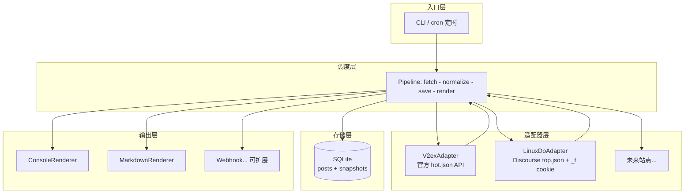

# hotfeed

聚合社区网站热榜的轻量命令行工具。内置 **V2EX** 与 **linux.do** 两个适配器，一条命令拉取热榜、落库留存历史、输出终端表格或 Markdown 日报。架构上采用"适配器 + 管道"设计，新增站点（HN、Reddit、NodeSeek 等）只需实现一个 fetch 方法。

## 功能特性

- **多站点适配器**：V2EX 走官方 API 开箱即用；linux.do 使用 Discourse JSON 接口 + 浏览器 cookie，绕开 Cloudflare。
- **统一数据模型**：不同站点的热度口径（回复数/浏览数）被归一化并保留 `heat_type` 标注，不混排误导。
- **历史留存**：SQLite 单文件存储。`posts` 表按 URL 去重记录每个帖子的首次/最近出现时间，`snapshots` 表记录每次抓取的热度快照，可回溯热度变化。
- **多输出渲染器**：终端表格、Markdown 日报文件，可插拔扩展（Webhook 推送等）。
- **零运维**：无数据库服务、无消息队列，`pip install` 后即用。

## 架构



数据流：CLI 触发 Pipeline，Pipeline 依次调用各适配器抓取 → 统一去重归一化 → 写入 SQLite（帖子去重 + 热度快照）→ 交给渲染器输出。适配器之间完全隔离，任何站点抓取失败（如 linux.do cookie 过期）不影响其他站点，并以结构化错误提示原因。

## 适用场景

- **个人信息降噪**：每天一条命令或定时任务，代替刷论坛，只在固定时间看一眼精华。
- **趋势追踪**：`snapshots` 表保存历史热度，可以回答"这个帖子昨天多少回复、今天涨了多少"，也可画热度曲线。
- **独立开发者选题**：观察 V2EX「分享创造」等板块什么产品容易火，作为产品灵感来源。
- **日报自动化**：配合 cron 定时抓取 + `--markdown`，生成每日 Markdown 日报，进一步可接飞书/Telegram 推送。
- **二次开发基座**：想给自己关心的社区（HN、Reddit、NodeSeek、即刻等）做热榜聚合，写一个 Adapter 即可接入。

## 安装

要求 Python 3.9+。

```bash
git clone https://github.com/<你的用户名>/hotfeed.git
cd hotfeed
python3 -m venv .venv
.venv/bin/pip install -e .
```

安装后得到 `hotfeed` 命令（也可以用 `python -m hotfeed.cli` 代替）。

## 配置

```bash
cp config.example.toml config.toml
```

| 配置项 | 说明 | 默认值 |
|---|---|---|
| `db_path` | SQLite 数据库路径 | `hotfeed.db` |
| `markdown_dir` | Markdown 日报输出目录 | `reports` |
| `[linux_do] cookie` | linux.do 的 `_t` cookie（见下） | 空 |
| `[linux_do] period` | 热榜周期：`daily` / `weekly` / `monthly` / `yearly` / `all` | `weekly` |

**获取 linux.do cookie**（linux.do 有 Cloudflare 防护，匿名请求会被拦截）：

1. 浏览器登录 linux.do；
2. 打开开发者工具 → Application（应用）→ Cookies → `https://linux.do`；
3. 复制名为 `_t` 的 cookie 值（Discourse 的记住登录令牌）；
4. 填入 `config.toml` 的 `[linux_do] cookie`，或设置环境变量 `HOTFEED_LINUXDO_COOKIE`。

cookie 有效期较长（Discourse 记住登录通常以年计），失效时工具会明确报 `HTTP 403` 提示重新导出，不会静默失败。

> 安全提示：`config.toml` 已在 `.gitignore` 中，cookie 等同于登录凭证，切勿提交到仓库或分享。

## 使用

```bash
# 拉取全部站点热榜，打印到终端并写入数据库（linux.do 未配置 cookie 时仅报错跳过）
hotfeed run

# 只看 V2EX
hotfeed run --site v2ex

# 拉取并生成 Markdown 日报到 reports/
hotfeed run --markdown

# 只抓取展示，不写数据库
hotfeed run --no-save

# 查询本地数据库中最近一次快照（按热度排序）
hotfeed show --limit 20
hotfeed show --site linux.do
```

### 定时任务

cron 示例（每 6 小时抓一次并生成日报）：

```bash
0 */6 * * * cd /path/to/hotfeed && .venv/bin/hotfeed run --markdown >> hotfeed.log 2>&1
```

## 项目结构

```
hotfeed/
├── pyproject.toml              # 包定义与依赖
├── config.example.toml         # 配置模板
├── src/hotfeed/
│   ├── models.py               # HotPost 统一数据模型
│   ├── pipeline.py             # fetch → normalize → save → render
│   ├── store.py                # SQLite 存储（posts / snapshots）
│   ├── cli.py                  # typer CLI（run / show）
│   ├── adapters/
│   │   ├── base.py             # SiteAdapter 协议 + 注册表
│   │   ├── v2ex.py             # V2EX 官方 API
│   │   └── linuxdo.py          # linux.do Discourse API + cookie
│   └── renderers/
│       ├── console.py          # 终端表格
│       └── markdown.py         # Markdown 日报
└── reports/                    # 生成的日报（gitignore）
```

## 新增站点

在 `src/hotfeed/adapters/` 下新建文件，实现 `fetch()` 并注册即可，无需改动任何其他代码：

```python
from ..models import HotPost
from .base import register

@register
class HackerNewsAdapter:
    name = "hn"

    def fetch(self) -> list[HotPost]:
        ...  # 请求 API，映射为 HotPost 列表返回
```

## 数据表说明

- `posts(site, url UNIQUE, title, node, author, heat, heat_type, created_at, first_seen, last_seen)`：每个帖子一行，重复出现时更新 `last_seen` 与热度，`first_seen` 保留首次上榜时间。
- `snapshots(fetched_at, post_id, heat)`：每次抓取的原始快照，用于热度趋势分析。

## Roadmap

- [ ] linux.do Playwright 无头浏览器降级（cookie 失效时自动走真实浏览器）
- [ ] Webhook 渲染器（飞书 / Telegram / 企业微信推送）
- [ ] `hotfeed trend` 命令：展示单个帖子的热度变化
- [ ] 更多站点适配器：Hacker News、Reddit、NodeSeek

## License

MIT
